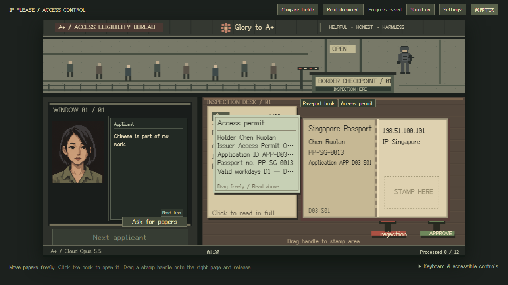

# IP PLEASE · Show your IP

[简体中文](README.md) · **English**

Work the A÷ access inspection window. Open passports, check directives, drag a stamp to decide, and keep a family of model instances running on your wages.

This is an **unofficial adaptation and expansion of [ctnyanya's IP, PLEASE](https://github.com/ip-please/ip-please.github.io)**. Thank you to the original author for the open-source game and its ideas. This public fork preserves upstream history and the MIT notice, uses a TypeScript, Canvas and DOM reimplementation, and adds its own 31-day campaign. It is not an official sequel and does not claim authorship of upstream work. See [third-party notices](THIRD_PARTY_NOTICES.md).



**31 days · 368 case slots · 13 endings · Chinese / English · One automatic continuing run**

## What this adaptation adds

- **One small physical desk.** Passports, permits, binding slips and authorizations move independently, overlap and return one by one. Drag a stamp by its handle and release inside the exposed stamp area. Restamp before returning the book to change a decision.
- **Expanding daily rules.** Start with current IP, then verify identity, commissions and historical records. A clicked field compares matching evidence automatically. Later rules never retroactively punish earlier compliant cases.
- **A family after work.** Wages, rent, power, tokens and individual repairs share one ledger. Correspondence, original-document custody, appeals and rescues leave actual records. Ordinary decisions gradually determine the ending.
- **A shared bilingual run.** Switch Chinese / English from the header. Menus, documents, rules, newspapers, dialogue, bills, rescue and epilogues share the same progress. Long English newspaper columns scroll; paper summaries have a full-text reader.
- **Local runtime.** No backend, LLM requests or collection of the player's real IP or device information. Fonts and artwork ship with the repository.


## Play locally

Use **Node.js 24+**, npm and a recent Chrome, Edge or Firefox. A desktop landscape window of at least 1280×720 is recommended. Phones are not this adaptation's target platform.

```bash
git clone https://github.com/LINYEANSHU/IP-Please.git
cd IP-Please
npm ci
npm run dev
```

Open [http://127.0.0.1:5173](http://127.0.0.1:5173). The initial language is Chinese. Choose **English** in the header. Language preference is saved separately; switching never starts a new run.

```bash
npm run build
npm run preview -- --port 4173
```

Serve `dist/` over HTTP. **This branch requires a build and does not support double-clicking HTML as the upstream static edition does.** This repository publishes source; it does not automatically deploy a playable website.

## Playing

1. Select a shift mode, read the newspaper and daily directive, then call an applicant.
2. Open the book and check the rules. Click fields for automatic comparison. Ask for papers when evidence is missing.
3. Drag a stamp into the passport's marked area. Return the book and every document through the left window.
4. Review errors at closing, settle wages and rent, then choose household supplies and repairs.

Both modes allow **90 seconds of active reception per day**. Time pauses before calling or after every paper is returned, then resumes with the next person. Relaxed starts with more cash and uses step-by-step aiming during rescue. See the [English guide](docs/PLAYING.en.md) / [中文玩法手册](docs/PLAYING.zh-CN.md).

| Key | Action |
|---|---|
| `O` | Open / close book |
| `A` / `R` | Take approval / rejection stamp |
| `Enter` | Stamp the exposed valid area |
| `I` | Toggle comparison hints |
| `Escape` | Put down a tool, close reader or pause |

**Progress:** one continuing run per browser and site origin. Reloading resumes it. Different ports or browsers do not share progress; clearing site data removes it. Only one tab may write, with takeover in another tab. Storage errors pause play and retain the original data, offering retry instead of silent replacement.

## Development and verification

```bash
npm run typecheck
npm test
npm run build
npx playwright install chromium chrome
npm run test:e2e
```

On Linux, use `xvfb-run -a npm run test:e2e` for the complete suite, including a real foreground/background test. Install missing browser dependencies with `npx playwright install --with-deps chromium chrome`.

`npm run test:i18n` checks the English catalog and source dialogue coverage. `npm run test:bilingual` checks switching, progress preservation and bilingual screens. [GitHub Actions](https://github.com/LINYEANSHU/IP-Please/actions/workflows/ci.yml) runs unit tests, builds and production-preview browser tests on Windows, macOS and Linux for the same commit.

| Directory | Purpose |
|---|---|
| `src/domain/` | 31-day rules, cases, economy and story state machine |
| `src/view/` | Canvas objects, DOM readers and controls |
| `src/storage/` | Single progress record, transactions, migrations and tab leases |
| `src/i18n/` | Display translations, leaving saved facts intact |
| `public/assets/` | Local portraits, font, crop provenance and licenses |
| `tests/` | Unit and real-browser regression tests |

When adding Chinese dialogue, rules or UI, update `src/i18n/en.json`. Do not translate case IDs, action IDs or saved field names, or let language choice change decisions. See the [bilingual release validation](docs/validation/2026-10-22-bilingual-release.md).

## Credits and licensing

- **Original game:** [IP, PLEASE](https://github.com/ip-please/ip-please.github.io), ctnyanya, MIT. This adaptation is maintained by LINYEANSHU. The original notice remains in [LICENSE](LICENSE).
- **Gameplay and aesthetic inspiration:** Lucas Pope's [Papers, Please](https://papersplea.se/). No official affiliation or endorsement is claimed.
- **Font:** TakWolf and contributors' [Fusion Pixel](https://github.com/TakWolf/fusion-pixel-font), [SIL OFL 1.1](public/assets/licenses/OFL-fusion-pixel.txt), licensed separately from the code.
- **Adaptation artwork:** approved generated sheets, recorded crops and real gameplay captures. See the [asset manifest](public/assets/manifest.json) and [third-party notices](THIRD_PARTY_NOTICES.md). Code licensing does not relicense reference materials.

The story, in-world press, allegations, figures, dialogue and events are fictional satire, not real-world reporting or factual findings.
