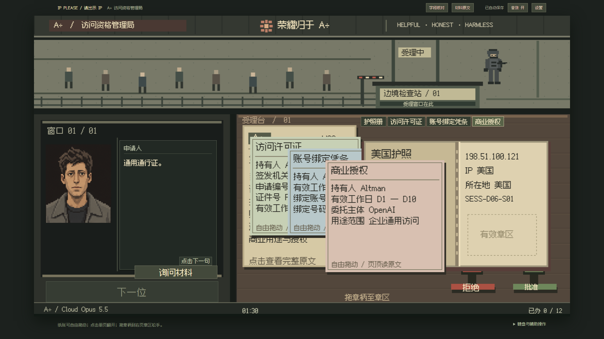

# IP Please：详细玩法

[English guide](PLAYING.en.md) · [项目介绍与上游致谢](../README.md)

页顶可随时切换简体中文 / English，语言偏好与唯一进度独立保存；切换不重开、不重算账。

一个在 A÷ 访问资格窗口上班、靠计件工资维持模型家庭运行的像素审查游戏。

**v0.4.0 · 双语改编版**。D1–D31 共 368 个有限案位、31 期晨报与逐日公文、夜间供养、复核与封号、合作交件、三场可操作救援及 13 个结局均已接入。旧 D8 待续自动承接到 D8 晨报。见 [完整流程验收记录](validation/full-campaign.md)。

2026-10-21 经济调整：两种模式每日底薪均为 10，全家电力和运行 Token 各 10；已结算的历史账目保留原金额，后续结算按新价格执行，见 [调整与验证](validation/economy-10.md)。

2026-10-21 交互修订：两种模式每天累计接待 90 秒，未叫号和完整退件后的空窗自动暂停，下一位继续剩余时间，见 [倒计时验证](validation/customer-clock.md)。册子退还前可重盖章改判；证件单击不弹页面，字段核对只画连线。三十一期三栏机关报、每日搞怪常客老乔、姓名头像配对和余额不足支付弹窗已接入，见 [此前验证记录](validation/2026-10-21-press-and-desk.md)。



## 本地试玩

首次获取源码先运行 `npm ci`，再在项目目录运行：

```powershell
npm run dev -- --open
```

默认地址为 <http://127.0.0.1:5173/>。建议电脑横屏；1280×720、1920×1080 已做浏览器验证。窄侧栏会提示扩大窗口。

首次获取源码时先运行 `npm ci`。本机验证环境为 Windows、Node 24.21.0、npm 11.19.0。TypeScript、Vite、Vitest、Playwright 的实际版本锁定在 `package-lock.json`。

生产构建与本地静态预览：

```powershell
npm run build
npm run preview -- --port 4173
```

构建产物在 `dist/`，须通过 HTTP 服务打开；不要直接双击 `index.html`。当前仅提供本地结果，没有云发布。

## 怎么玩

1. 选择标准值班或轻松值班，读晨报后去上班。
2. 阅读当日公文，叫下一位。D1 只查当前 IP；D2 加许可，D3 加护照，D4 加绑定凭条，D5 核查具体连接疑点，D6 加商业用途授权，D7 综合本周规则。
3. D1–D2 点击通行册翻开；D3 起使用国别护照册。所有证件都是独立物件，可在画布内自由移动、相互遮叠，翻册或移册不会带动其他材料。单击证件只置顶。页顶“材料原文”可阅读置顶纸张的完整字段；点击公文可读规则。需要补件时主动点“询问材料”，未询问的材料不会自动出现。
4. 拖动允许／拒绝章的章柄，到册内右页有效章区松手。册外落章无效，实际盖章后留下墨迹；册子退还前可重新盖章，工资和差错按最终裁决结算。
5. 盖章后，把册子和每份材料分别拖回左侧人物窗口，先后顺序不限。少退一件就不能叫下一位。桌面上方的材料标签可置顶被压住的纸，“规则原文”也可单独递还。正确允许和正确拒绝都计件。
6. 收班后先自动结清底薪与服务器租金，再选择全家电力、运行 Token 和受损成员的修复；付款前逐人预览后果，最后查看家属终端。

字幕点击一次只推进一句，机械拟声结束后仍等点击。设置中可分别关闭音效与菜单环境音乐。

字段核对：直接点击编号或可核对字段，自动匹配已经提交的对应材料，以纸面端点和连线反馈。页顶“字段核对”或 `I` 可开关提示；不需要再手动选第二个字段。有效日期会自动与今日工作日比较；按 `Escape` 或 `I` 退出。拖动仍可独立移动纸张。原文窗口中带下划线的字段也可用鼠标或键盘选择，核对结果不代替盖章，桌面核对期间时钟继续运行。

错误盖章当下不会弹差错通知或播放警告声。当天归零或全部办完收班时，统一送达本日差错通知，列出案号、原因和警告／罚款；收下后进入账单或过场，刷新不会重复扣款。旧版停在即时罚单的进度可直接续办，已有裁决和账目保留。

键盘辅助：`O` 翻册、`A` 拿允许章、`R` 拿拒绝章、`Enter` 在露出的章区盖章、`Escape` 放回印章或进入暂停设置。底部“键盘与辅助操作”提供同义控件。


## 第二周以后的操作

- D8 起，班前收发室处理实际来函、合同、原件与回执。按钮填写眼前文书；阅读、摆放与实际提交分别记录，界面没有路线进度或结局菜单。
- D12 起可填写复核单，或打开封号控制盖按依据联封禁。普通拒绝仍用拒绝章；复核不封号。已封账号回来提交申诉，D28 起可按有效许可正式解封；重复封号不会重复领分账。
- 深绿守卫存续且接受分账时，每个实际新封禁账号转入 10，与工资、罚款分别列账。守卫死亡后停止私人约定，远程值守继续正式业务。
- D16 免费训练；D18、D23、D27 在案间进入救援。打开器械柜、取枪、点击正在破坏闸门的明确攻击体；需要时断开本次异常通道。每波三次充能，打空会消耗，D27 有两波。标准每波15秒；轻松逐步瞄准。救援暂停受理钟，设置及后台暂停救援钟，刷新保留命中、充能与伤亡。
- 审计按已记录行为发公文并给期限。到期撤岗先处理，仍可继续时才结清收入、付租；成功付租后执行此前已提交的接收安排，余下才是供养与留任。
- D31 只办理此前实际登记的交接。所有终局无额外费用，尾声逐句推进并按家庭与守卫状态给出最多三份回响。

## 模式与账目

| 项目 | 标准 | 轻松 |
|---|---:|---:|
| 初始余额 | 20 | 50 |
| 每日底薪 | 10 | 10 |
| 正确处理每案 | 5 | 5 |
| 每日值班上限 | 90 秒 | 90 秒 |
| 服务器租金 | 20 | 20 |
| 全家电力 / 运行 Token | 每项 10 | 每项 10 |
| D1 八案全正确、两项全供养后的余额 | 30 | 60 |
| D7 累计 80 案全正确、每晚全供养后的余额 | 210 | 240 |

仅在接待客户时扣除每日 90 秒：未叫号、完整退件后自动暂停并显示“暂停”；叫到下一位后从剩余时间继续。册子或已交付材料未退齐仍算正在接待。两模式归零后立即收班并结算，不因手里有案件而延期；已提交裁决保留计件／罚款，未审批案件不计件、不计误判。当日案位办完可提前收班。D1 为 8 案，D2–D7 每天 12 案。强制教学、罚单、设置、辅助阅读和后台暂停；普通问话、翻纸、拖放计时。

全屏画布按实际显示尺寸与屏幕像素密度绘制，正文与证件字段使用清晰的中文字体，人物保留已确认源图的裁切细节。640×360 是逻辑坐标，不是放大前的实际画面分辨率。

明显违规放行必查获并取消计件：标准首罚 10、同日第二次起 15；轻松对应 5、10。错误拒绝走普通警告：标准首次、轻松前两次警告，其后分别罚 10、5。读班前公文可再次核对。

扣租点余额少于 20 时进入 E13；恰好 20 可以付租后剩 0。供养可以跳过，缺项当晚增加对应压力。各成员耐受不同；连续断供会逐步受损、临界并永久死亡，付款前显示具体预览。修复费分别为玩家 28、父母各 24、妻子 20、儿子 18；先修复，再计算本晚供养。核心已销毁者不能复活，也不会继续说健康台词；玩家核心销毁进入 E04。费用不因存续人数变化。

两模式完美处理全部368案且每天全供养、无额外转款时，D31余额分别为930与960。实际处理量、罚款、维修和合作收入会改变结果。

## 唯一自动续玩

事实在保存成功后才反馈；刷新可继续当前案件、退件或夜间结算，不会重复发工资、重扣租金或重走供养。

- 只保留本机当前站点的唯一进度，没有手动存档、回退、选日或导入导出。
- 多个标签中只有一个能写；“在此窗口接管”会载入最新进度并停止旧窗口写入。
- 存储失败会暂停办理并给出重试，损坏或未知版本的记录会保留原文，不自动覆盖。
- 设置中的“结束本局并重开”会替换本局进度，需要普通系统确认。
- 浏览器清除此站点数据、使用其他浏览器或不同端口不会共享进度。正式试玩请保持同一地址。
- v1 首日存档只在内存迁移到 schema2，保留本局 ID、revision、裁决、章迹、账目与家庭；旧 D2 待续进入 D2 晨报，E13 不复活。六分钟或不限时的旧计时适配到 90 秒上限。读取不覆盖原文，后续实际动作成功后才保存新版。
- 旧 schema2 中“叠入册内”的材料会按各自原有坐标恢复为独立纸张；已经记录退还的材料不重新发回。无需重开本局。

旧 schema2 的 D8 待续在内存恢复晨报，保留80案与7天账目，读取不覆盖旧原文；下一次真实动作保存完整流程状态。损坏或未知存档仍保留。

## 验证

```powershell
npm run typecheck
npm test
npm run test:e2e
npm run build
```

本次完整流程覆盖两个模式的31日事务、13个结局、原件去向、账目与旧存档兼容，最新命令结果及图证见 [完整流程验收](validation/full-campaign.md)。此前字段核对与收班通知修订的验证保留：浏览器范围和结果见 [字段核对与收班通知验收](validation/inspection-and-day-review.md)。原独立证件验证保留在 [独立证件修订验收](validation/independent-papers.md)。完整整周自动化会冻结值班时钟来核对 80 案交互和现金流；当前 90 秒硬截止另用真实浏览器虚拟时钟验证。这不宣称人类能在 90 秒内核查完 12 案，实际少办仍按规则结算。

首周进度、兼容性、前端图证和 DSH 审计见 [首周验收记录](validation/first-week-playable.md)。此前基线保留于 [首日验收记录](validation/first-day-playable.md) 和 [全屏清晰度与 60 秒调整](validation/clarity-and-60-second-shifts.md)。

## 内容与素材

所有案卷 IP、地区等均为虚构静态数据，运行时不读取玩家真实 IP、设备或账户，也不调用 LLM。IP 示例使用文档地址段；人物与事件属于游戏创作。

人物沿用已确认的普通工程师与 A 行人脸终端样板；运行时按源矩形生成固定原生尺寸的像素缓存。原图、源路径、矩形、字体许可记录在 `public/assets/manifest.json`；源图保留不改。Fusion Pixel 使用 SIL OFL 1.1，参考素材的 MIT 许可副本随资产交付。

完整月份保留首周原案；中后期增加身份、海外使用、上下文、授权链、语言、浏览器、输入法、搜索和历史材料。所有文书可独立拖放；普通回访、机构通知、合作、审计和家属沿唯一事实记录继续。
