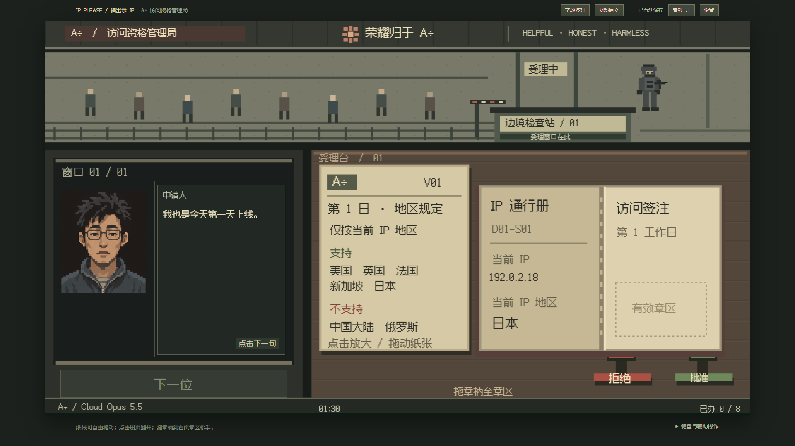

# 全屏清晰度与 60 秒值班调整

2026-10-20，依据用户首日试玩反馈；2026-10-21 收尾归档。范围仍为 D1 可玩闭环。

## 验收目标

- 画布的实际像素尺寸匹配显示尺寸与屏幕像素密度；全屏充分使用可用空间，拖章与纸张命中保持准确。
- 证件、规则、字幕、按钮与账单清晰可读；已确认人物保留源图细节，原设计图和源矩形保持不变。
- 两模式值班时间上限均为 60 秒；从“开始值班”后运行，归零立即收班，不能因在场案件未批而延期。
- 归零时已提交裁决正常计入工资／罚款，未审批的案件不造裁决和误判；未退件的已提交裁决也可正常结算与续玩。
- 保持既有暂停、事务、一次性账目与唯一续玩；兼容原来的六分钟和轻松不限时存档，载入时仅内存适配。

## 变更前证据

全屏原画面：`proofs/clarity-before-1920.png`。变更前程序与测试完整副本及 SHA-256 保留在本地 `.superpowers/worker-audit/clarity-60s-before/`。

根因：640×360 实际画布整体放大；人物源矩形被提前缩成低分辨率缓存；12px 位图字体以更小字号绘制证件中文。修复应分别消除这三处细节损失。

## 实现与画面检查

640×360 逻辑坐标保留，实际 canvas backing 随窗口与 DPR 重建，resize 后重绘。人物按源矩形原尺寸裁切缓存，Canvas 与 DOM 正文使用系统中文字体。晨报队列图按设备像素坐标裁切。原人物图、源矩形、字体文件和许可均未改动；三张人物图和字体的 SHA-256 与首日基线一致。

| 视口 | 显示尺寸（CSS 像素） | 实际画布像素 |
|---|---|---|
| 1280×720，DPR 1 | 1063.11×598 | 1063×598 |
| 1920×1080，DPR 1 | 1703.11×958 | 1703×958 |
| 2560×1440，DPR 1 | 2343.11×1318 | 2343×1318 |
| 1920×1080，DPR 2 | 1703.11×958 | 3406×1916 |

主 Agent 已直接检查标题、晨报、桌面、夜间账单、家属页和 DPR2 图像，文字可读，章区及主要按钮完整；源人物细节和现有三分屏风格保留。新证据使用 `proofs/clarity-*.png`，旧首日证据保留作比较。

## 60 秒规则与续玩

标准、轻松均为 60000ms 上限，点击“开始值班”后即走表，不要求先叫号。班前、强制教学、罚单、设置、辅助阅读与失焦暂停保留。计时归零立即进入 night，随后自动执行一次结算；八案全办完仍可提前收班。

鼠标拖章及键盘持章跨过归零后不能裁决；已保存的裁决和工资／罚款保留，未审批案件不造裁决、不计件、不判错。账单明确列出已裁决、已退件、待退件和未审批数量。

旧 v1 标准剩余时间超过 60 秒时在内存截到 60000，旧轻松 null 转 60000；合法旧加班状态在归零时转入收班。读取不写回原始存档；经济、案号、裁决、章迹、家属、租金及供养保留。结构损坏、非法归零 returning 和未知版本仍拒绝，保留原字符串。后续正常 tick／settle 事务会按原 CAS 机制自动保存。

## 主 Agent 独立验收

| 检查 | 结果 |
|---|---|
| 类型检查 | 通过 |
| 全量 unit | 56/56，8 个文件，通过 |
| 生产构建 | 通过 |
| 全量开发预览 E2E | 27/27 通过，1.6 分钟 |
| 静态构建的时钟、分辨率、两模式整日与视觉 E2E | 15/15 通过，42.5 秒 |

新增目标单测实际先有 16/16 失败，再通过相同 16 项，之后扩展到当前全量 56 项。最终浏览器验收覆盖无人叫号、未盖章、已盖章未退件、部分已办、鼠标与键盘持章、刷新续时，以及 1280／1920／2560／DPR2／resize。

最终独立命令链退出码为 0。最后一次验收开始前保存了源码哈希，用于确认验收期间源码没有变化；开发预览与静态构建的输出目录相互隔离。

第一次主验收提前与 DSH 自身的 Playwright 测试并行，共享输出目录导致 trace 文件冲突，该次结果不计通过。独立静态构建又发现首案测试脚本没有等待教程关闭事务，已由第二个 DSH 任务只修改 helpers：等按钮隐藏并确认存档 pauses 已清除，保留真实鼠标操作，不加固定延时或放宽超时。最终所有验收串行执行，输出分别放入本地审计目录。

Impeccable 仍仅提示晨报的 3px 报头横线；实际是方角旧报纸的印刷线，保留既定样式。

## DSH 与风险审计

- `hub-5-mvgspo81` 完成实现：140 项外层工具调用、203 项 PTC 内部调用。
- `hub-6-mvgtrnwy` 只修测试等待：15 项外层调用、20 项内部调用。
- 两任务均为当前目录、PTC、默认 Flash/max、完全权限，均自然完成；子任务产生的审批请求为 0。
- 主 Agent 已读取完整工具／命令／结果／权限记录并对比基线。写入限于上述程序、测试、缓存元数据及本地临时测量／OCR／差异脚本；临时脚本已删除，仅删其自行创建的具体文件，没有递归删除。未发现需回滚的改动。未改依赖、全局配置、凭据、原图或许可，未发布。辅助图像工具未成功执行，不作为视觉验收依据。
- 曾尝试提前终止仍在运行的写入任务，被自动审批以可能中断写入为由拒绝；未终止任务，后续等待自然结束后继续验收。当前没有因此遗留的阻塞。
- 原始审计与前后文件副本保留在忽略目录 `.superpowers/worker-audit/`，不作为公开发行内容。以后派工进一步限制单次范围：目标测试通过即返回，由主 Agent 统一承担全量与视觉验收。
