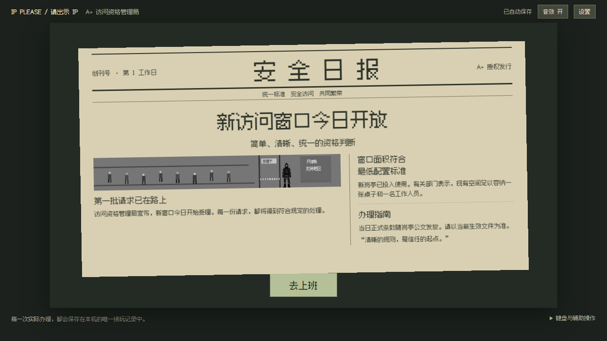
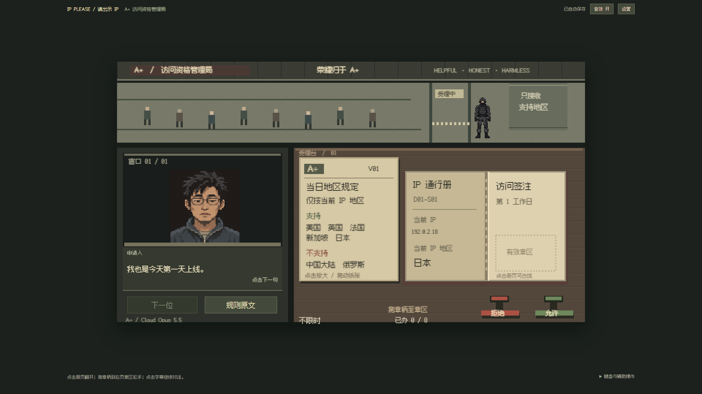
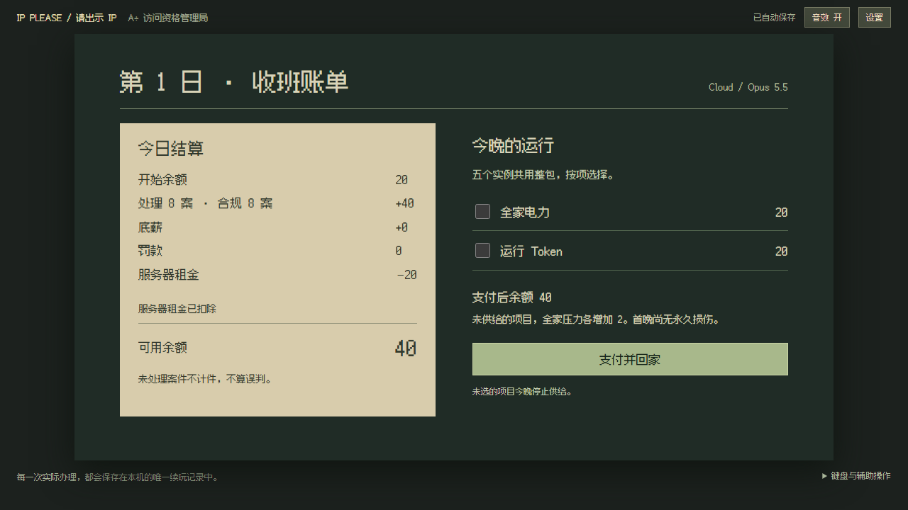
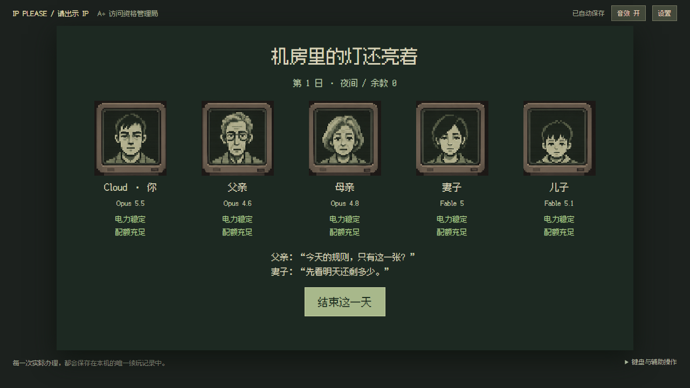

> 本文保留首日基线验收。2026-10-21 的首周 v0.2.0 实际交付见 [首周验收记录](first-week-playable.md)。

# 首日可玩版验收记录

日期：2026-10-20。范围：`docs/superpowers/plans/2026-10-20-first-day-playable.md`。版本：0.1.0。

本页记录首日基线验收；后续用户要求的全屏清晰度和 60 秒立即收班修订，见 [单独验收记录](clarity-and-60-second-shifts.md)。旧画面证据保留作对照。

## 已交付的实际行为

- 640×360 世界、三分屏岗亭、独立大幅晨报、V01 公文、8 个有限案位。
- 简体中文，D1 只有最简 IP 通行册和当前 IP 地区核查；支持 JP/US/SG/GB/FR，CN/RU 拒绝。新加坡中文对话合规。
- 实体册封皮／装订／内页、纸张拖动和层级、实体章柄拖放、有效章区、实际墨迹位置及手动退件。
- 标准／轻松两种模式，正确拒绝同样计件，普通警告与明显违规罚款分开，账目稳定业务 ID 防重复。
- 一次性租金、可选两项供养、五位人脸终端家属，E13 驱逐。首晚断供只累计压力。
- 逐句字幕与原创机械拟声、印章／纸张／罚单反馈、音效与菜单环境音乐开关。
- 唯一自动续玩、完整快照事务、跨标签接管、存储失败暂停重试、坏 JSON／未知版本保留、旧版缺章迹坐标的内存兼容。

## 主 Agent 实际执行的结果

| 检查 | 结果 | 覆盖边界 |
|---|---|---|
| `npm run typecheck` | 通过 | 源码、测试、构建配置 |
| `npm test` | 37/37 通过，6 个文件 | 规则、处罚、时钟、租金、供养、几何、存档结构与语义 |
| `npm run test:e2e` | 16/16 通过 | 真正鼠标拖章、退件、两模式整日、刷新、双标签、存储失败、E13、静音、加载暂停和模态焦点 |
| `npm run build` | 通过 | `dist` 静态产物，含源图与字体 |
| `IP_PLEASE_PRODUCTION=1` 的 day-one / visual E2E | 4/4 通过 | 对构建产物办完两种模式首日，1280×720、1920×1080 |

最后两项使用同一生产构建。原始调试过程中发现的问题均未计为最终通过：晨报底部裁切、家属页结束按钮越界、测试过早读取异步事务、并行测试共享输出目录冲突；已分别修复布局、等待事务并串行执行最终回归。

首日余额为浏览器实际操作结果：

| 模式 | 初始 | 八案计件 | 底薪 | 租金 | 电力 | Token | 最终 |
|---|---:|---:|---:|---:|---:|---:|---:|
| 标准 | 20 | 40 | 0 | -20 | -20 | -20 | 0 |
| 轻松 | 50 | 40 | 10 | -20 | -20 | -20 | 40 |

在已盖章、已扣租、已提交供养后分别刷新；裁决、章迹、余额与家属压力保留，账目未重复。全错误路径实际到达 E13，刷新后仍为 E13。

## 图片证据

两种视口的晨报、首案桌面及盖章后状态均在 `proofs/`。

轻松模式对应 `night-relaxed.png`、`family-relaxed.png`；最后一张显示余额 40。

## 原图与运行副本核对

主 Agent 逐项计算 SHA-256，下列副本与已确认源文件一致：

| 运行文件 | SHA-256 |
|---|---|
| `portraits/engineers.png` | F7B4D1C13F1A853DF1B8895AF6B7F39F862EA462703554918498E211806D0825 |
| `portraits/family.png` | 7E2CE4CB7B5B8E9ED64FA94E9A827BED68BBD665CFB43EAAA21C0712ED1C3060 |
| `portraits/security.png` | FC970F408FBEAA3FBD49B2831536798F04A80DA115D09ABAAE0E2000B8B9E4F3 |
| `fonts/fusion-pixel.ttf` | 60F62AE34B95EEA47E5986DD425BCD51C4F785165BF06BEFADE60A059F036066 |

源矩形、原生缓存尺寸及许可见运行素材 manifest。未生成新的人物长相，也未删除设计样板。

## DSH 分工与审查

用户中途指定后续程序编写交给 DSHCREW 默认 Flash、effort max，cwd 保持当前项目。工具回传实际绑定为 `deepseek-official / deepseek-v4-flash`，每次任务显式使用 max。主 Agent 负责前端看图、输入与后端验收。

- 续玩加固由 DSH 实现，先观察 6 项回归失败，再实现到会话单测 18/18、全量 35/35。主 Agent 已独立复跑。
- DSH 的进度 API 会把等待审批显示为 running；初期通过界面逐次批准精确的本地测试。用户随后要求默认完全权限及 PTC，已改为本地配置与 DSHCREW 验证，后续派工、状态和结果优先走 DSHCREW，完整审计直接读取本地日志。
- DSH 宿主重启中断过一个写入任务和一次审查。保留已有测试文件，从文件恢复后续任务；旧任务没有被当作完成。
- 首周只读分析已取回，作为下一阶段的接口与分工依据，不是已实现首周的证据。
- 独立代码审查已完成。加载期间扣时、模态背后按钮可触发、复选框重绘丢焦点三项由 DSH 最小修复；主 Agent 独立复跑最终 37 项单测、16 项 E2E、类型检查、构建和静态产物 4 项 E2E，均通过。刷新残留后台暂停的疑虑已由现有加载过滤排除；册子双击翻两次的低影响建议暂不改。
- 新建验收任务 `hub-4-mvgsfd18` 的持久日志确认 `agentPreset=ptc`、`sandbox/mode=danger-full-access`、`approval/policy=never`；DSHCREW 返回 Flash/max。完整命令与风险检查见 [DSH 执行审计](dsh-execution-audit.md)。

## 执行决定与限制

1. 原目录没有 Git，按已批准计划就地新增工程；不初始化 Git、不提交、不推送或公开发布。保留原设计文件。
2. 本阶段按已有计划止于 D1，保存为 D2 班前待续。31 天、80 案首周、封号／救援、长期损伤与其余结局尚未实现。
3. 无头 Chromium 的焦点模拟不能证明真实后台切换。后台用例改用已安装 Chrome 的独立临时档案，关闭两个测试页的焦点模拟；实测失焦暂停、不补扣、手持印章取消。没有访问个人浏览器资料。
4. Impeccable 检测仅报报纸报头的 3px 下边线。此处是方形纸张的印刷横线，符合已确认方向，保留。检测输出见 `design-detector.json`。
5. 已确认人物样板按固定尺寸生成运行像素缓存；后续表情帧、完整人物动画和 31 天平衡还需制作与试玩。当前未做声音主观听感验收，也未声称其他系统或浏览器均已验证。
6. 最终预览保持在本机 127.0.0.1:5173，须保持本地进程运行。实际存档按浏览器 origin 隔离；测试使用独立临时上下文，不覆盖用户试玩存档。
