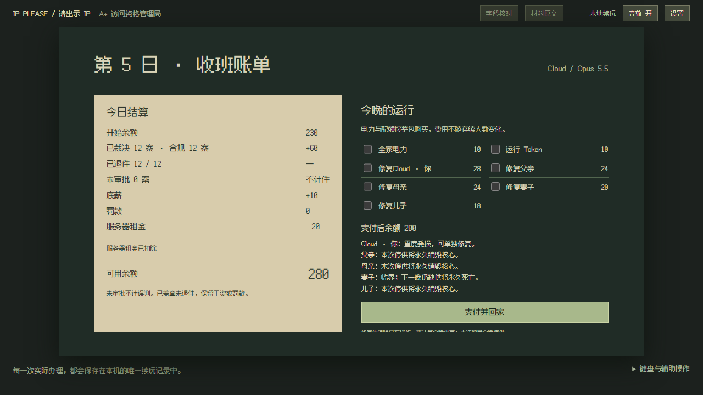

# 首周可玩版验收

2026-10-21，v0.2.0。范围为 D1–D7 的 80 个有限案位，保存到 D8 班前待续。完整 31 天与其余结局尚未完成；没有公开发布。

同日后续用户修订已删除册内叠件与批量退还，改为独立证件自由摆放、逐件递还；最新行为和测试见 [独立证件修订](independent-papers.md)。下文测试数量属于当时首周基线。

## 实际行为

- 两模式每天有效值班上限 60000ms。归零同事务停止受理、保留已裁决账目；未审批不计错、不计件。所有案位提前办完仍可收班。强制公文、教学、罚单、设置、原文和后台继续暂停。
- D1 当前 IP；D2 许可机关、申请编号和首尾包含的有效期；D3 国别护照姓名、证件号；D4 本人账号和绑定；D5 明确连接疑点与当前会话佐证；D6 商业授权范围；D7 综合。国籍、号码号段、单个风险标签不会自动变成禁入条件。
- 主动询问才交补件；已实际交出的正确替换件参与判定，错件仍须退还。无当日有效补件的案件不会凭求情生成许可。日常问话与拖放计时，不显示正确印章答案。
- 纸张有独立位置、层级、手动叠件和逐件递还；漏退一件禁止叫号。原文窗口只显示已实际交付的附件；可从标签或原文取回被压住的纸。常驻公文和父亲的唯一旧规原件不会进入申请人退件堆。
- 七天工资、底薪、租金、供养和修复采用稳定交易 ID，跨日保留案卷与账本。全正确、每晚全供养的标准模式 D7 余额 0，轻松余额 100。
- 缺电和缺配额分别累计压力，按个体阈值损伤，每晚最多一级；补足资源稳定已有损伤，修复先清损伤再计算本晚供养。临界风险与本次选择的永久死亡在付款按钮上方逐人显示。死人不能修复，不说健康台词；玩家核心销毁触发 E04，租金不足触发 E13。
- D7 班前父亲仍存续时，实际收到旧规原件；此前已死亡则不补寄。正常收班后逐句推进首袭，初始守卫 W00 固定牺牲，没有假救援按钮或额外家庭费用。刷新续接实际过场节点，不重算工资、租金或伤亡。

## 续玩迁移

存储键保留 `ip-please:run:v1`，内容版本升级为 schema2。新版验证器核对日次、案序、实际交付、裁决版本与账本金额；旧版验证器先验明 schema1，再在内存迁移。读取不写 localStorage，首次实际动作保存后才写新版。

在修改旧实现之前，由真实旧 reducer 生成了 18 份快照，覆盖两模式的报纸、班前、办件、盖章待退、未扣租、已扣租、家庭、旧 D2 待续，以及 E13。迁移保留 runId、revision、余额、裁决、落章、家庭与已有账目；旧 D2 待续转为真正 D2 晨报，E13 不复活。损坏或未知版本保留原文。

## 验证状态

- 类型检查：通过。
- 单测：16 个文件、103 项通过；含独立预期表的 80 案、补件前后、日期边界、绑定／连接／商业证据、连续断供、修复与死亡、全周经济和逐动作快照验证。
- 生产构建：通过，23 个模块；JS 101.84kB、CSS 11.91kB。
- 浏览器：全量 dev 32/32 通过（8.2 分钟），含两模式各一次真实鼠标完成 80 案；静态构建 16/16 通过（49.6 秒），覆盖硬截止、高分辨率、D1 全日和首周新增界面／D7 截止。最终串行命令退出码 0。

整周鼠标测试冻结时钟以核对 80 案的材料操作、经济与连续剧情；硬截止另用虚拟时钟运行浏览器 interval 验证。测试不能证明玩家在真实 60 秒内办完全部 12 案，未审批会正常影响收入。

主 Agent 亲自检查 1280×720 与 1920×1080 的新纸张、询问字幕、原文、风险预览、死亡终端和首袭。修正了绑定条行距、补件字幕、夜间危险提示遮挡和设置面板被夜间保存误关的问题。画布继续按 CSS 尺寸乘 DPR 绘制，已确认源图不压成低分辨率缓存。

## DSH 与主 Agent 分工及审查

用户本轮改为主 Agent 约 60%、DSH 约 40%。主 Agent 编写核心 reducer、跨日／存档与旧版迁移、纸张渲染与输入、界面、夜间流程、回归和验收；DSH 负责案卷数据、纯规则与家庭投影及其三个单测文件。

本轮任务 `hub-1-mvhcsm3t`，会话 `session-d1b28f1c-e985-4e8a-87c5-522d4adab232`，实际模型 `deepseek-v4-flash`、effort=max、当前项目目录。DSH 服务通过本机 CLI 恢复；配置复核为 PTC，日志直接证实 `danger-full-access / never`。没有借浏览器协调 DSH。

主 Agent 已读取完整的 27 次外层工具调用、53 次 PTC 内层派发及结果。仅六个分配文件发生写入，四次 shell 调用均为指定的三个单测；RED 后观察到 35 项针对测试通过。没有凭据读取、安装、联网、部署、删用户文件或权限／全局配置修改，无风险改动需要回滚。项目开始前快照、源码哈希和原始调用记录保留在本地忽略目录 `.superpowers/worker-audit/`。

主 Agent 集成时另补齐了已存在图集的 P07/P09/P10/P12 与 M02 的裁切引用；M02 源表按原样复制，哈希相同。原图、原有裁切、字体和许可保留。一次机械设计检查只有原先报纸报头的 3px 横线被误报为圆角卡片边框，保留已批准的方角纸面设计。
