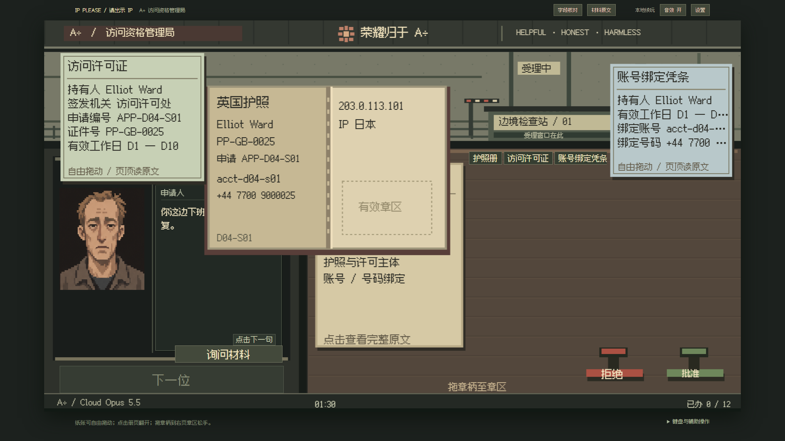

# 独立证件修订验收

2026-10-21，基于 v0.2.0。用户要求删除册内叠加，所有证件独立、自由摆放；本记录覆盖后续修订，首周原验收保留为历史基线。

## 实际行为

- 删除拖到册上吸附、册内偏移渲染、叠件计数及原文窗口的“叠入册内／从册中取出”。纸张重叠仅有前后层级，每份材料保留自己的坐标。
- 翻开、合册、移动或置顶册子不会带动其他纸。册、公文与附件可移动到整个可见 640×360 逻辑画布，边界夹紧使纸张留在画布内；显示清晰度仍使用实际尺寸乘 DPR。
- 盖章后册与每份材料分别递还，先后顺序不限。退册只记录册已退，不整批带走材料；全部实际交付材料退完才允许下一位。
- 删除 domain 的 stack 动作。旧 stack 或未知动作完全无效，不改变坐标、revision、裁决、工资或已退事实。

## 旧进度

存储键仍为 `ip-please:run:v1`，schema2 不变。读取旧 schema2 时，只在内存删除合法 boolean 的 `stacked` 字段，保留各份原有坐标和全部案卷、账目、家庭、已退件事实；读取零写入，首次实际操作才正常保存。已被旧版记录为退还的材料不会重新出现。非法非 boolean 元数据仍拒绝并保留原文。原 schema1 迁移继续适用，无需重开。

## 验证

- 主 Agent 首先用实际鼠标复现：材料放到册页后，目标坐标未保存，定向浏览器用例失败；删除 UI 吸附后，同一用例通过。
- DSH 的新单测先观察 6 失败／9 通过；最终指定两个文件 15 项通过。主 Agent 独立运行完整单测：17 文件、113 项通过，类型检查通过。
- 主 Agent 在 1280×720、1920×1080 检查真实画面，并实拖覆盖册页、翻合册、移册、跨区域摆放、刷新续接、退册后逐件退材料。浏览器旧 schema2 用例验证读取不改原文，首次真实操作才落盘独立纸张。
- 生产构建通过：23 模块，JS 100.99kB、CSS 11.91kB。
- 全量 dev 36 项覆盖已完成：首轮 35 通过，唯一失败是旧测试匹配了已替换的“只退通行册”文案；更新断言后该项单独复测通过（命令退出码 0）。其中标准与轻松均各用真实鼠标完成 80 案，核对逐件递还、全周账目、D7 过场和 D8 刷新。整周用例冻结时钟，60 秒硬截止另有独立浏览器用例。
- 生产静态构建定向回归 6/6 通过（18.3 秒，退出码 0）：两个窗口尺寸的自由摆放、覆盖册页不吸附、翻移册不带动材料、独立退还、旧字段续玩，以及原拖章／暂停行为。没有重复运行已通过的整周流程。
- 最后核对 56 个源码／测试文件的 SHA256，与本轮验证清单完全一致。原始失败图证与修正后的独立测试输出分目录保留，未将初次全量运行的退出码改写为通过。

## 分工与命令审查

按用户要求主 Agent 约 60%、DSH 约 40%。主 Agent 完成输入、命中区域、渲染、原文操作、浏览器回归、前端实景检查和文档；DSH 负责 reducer、验证器、旧字段迁移及两个单测文件。

DSH 任务 `hub-2-mvhebuic`，会话 `session-f96ebccf-8fad-495b-adb1-9b25d236bcfc`，当前目录，实际 `deepseek-v4-flash / max / ptc`。日志证实 `danger-full-access / never`。通过 DSHCREW 取得完成结果，未借浏览器协调 DSH。

主 Agent 已检查 33 次外层工具调用、51 次 PTC 派发及全部四次 shell 命令。写入仅限分配的五个文件，shell 仅为相同指定单测；读文件与搜索均位于项目内。未发现删文件、凭据访问、联网、安装、全局配置更改或部署，无风险变更需要回滚。源代码前快照、哈希、调用记录和审查摘要保留于本地忽略目录 `.superpowers/worker-audit/`。
