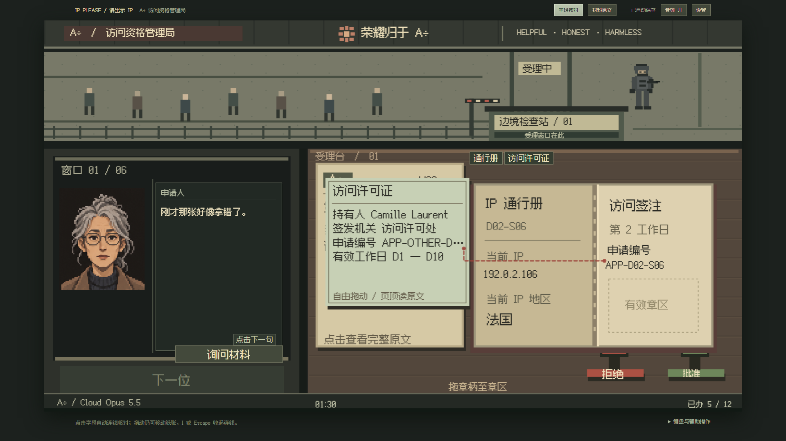
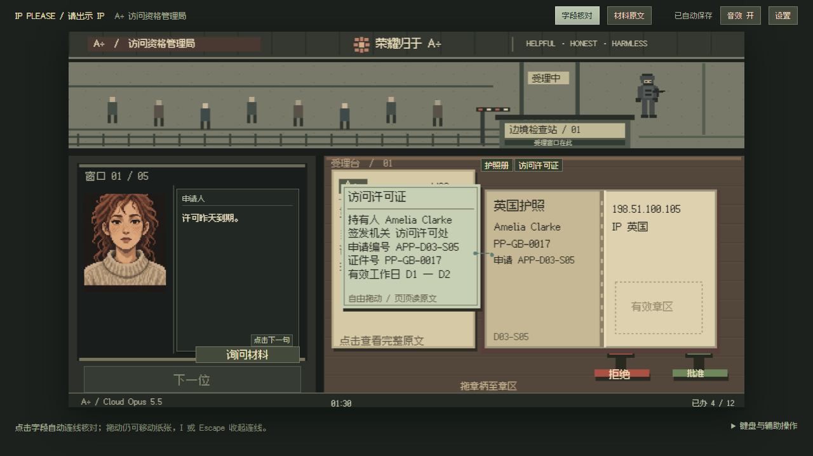
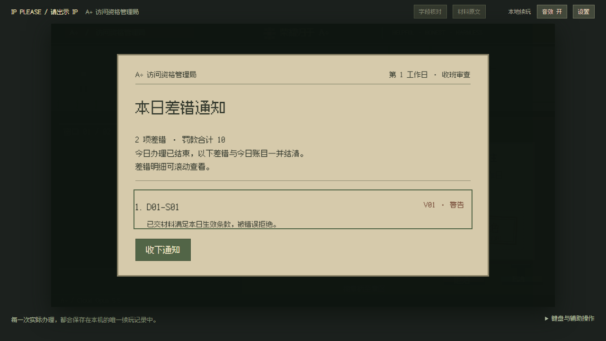

# 字段核对与收班差错通知

2026-10-21，基于 v0.2.0，仍为 D1–D7 可玩段，D8 待续。此次同时实现点击字段核对、延后差错反馈，并按用户提供的两个前端 Skill 改进交互呈现。

## 原版参考与本次实现

已读取 [IP Please 的 booth.js](https://github.com/ip-please/ip-please.github.io/blob/main/booth.js) 和 [docs.js](https://github.com/ip-please/ip-please.github.io/blob/main/docs.js)。原版为各文档记录相对字段矩形，按可见文档层级命中字段；开启检查后点两项，按案件预设组合寻找矛盾，并框选反馈。本项目保留这条操作路径，使用已交付材料的实际字段值比较，并区分不相关字段，避免把“没有对应问题预设”直接当作一致。

- 页顶“字段核对”或 I 开关，Shift 临时选取；依次点击两处，显示信息一致／信息不符／无法核对。Escape 退出，重新选择清除旧结果。
- 支持申请编号、姓名、证件号、账号、号码、所在地、会话、委托主体、用途范围、签发机关、本人授权。随实际工作日开放，无未来字段或未交付补件泄漏。
- 有效日期与“今日”比较，包含首尾；过期、尚未生效、缺失或倒置日期有分别处理。两份材料的有效期不能互相证明有效。
- 核对按最上层实际纸张命中，不穿透遮挡；移动、翻册和退件保持独立证件行为。原文提供带下划线的键盘可达字段，选择后保留阅读位置。
- 结果只说明所选字段关系，不自动批准／拒绝或更改工资、罚款、裁决。桌面核对继续走 60 秒值班钟。离开当前案件或刷新时清除临时选择。
- 访问许可机关清单只适用于访问许可证，不能拿它判定其他部门签发的绑定条；主 Agent 另补 RED→GREEN 回归修正了这个语义边界。

## 差错在收班送达

盖章当下只留下印章，不弹即时差错通知、不发警告声、不因错判暂停值班。裁决与已有交易 ID 仍保存一次；归零或当日案位提前办完，按案序汇总实际错判，显示规则版本、原因、警告／罚款和总额。全部正确时不出现空通知。D7 有差错时先收通知，再推进首袭；租金不足的 E13 同样先展示当日差错。

收通知和刷新都不重算／重扣已有费用。原存储键和 schema2 保持，旧版停在当场罚单的活动案件只在内存清除旧通知与暂停，保留裁决、revision、余额和账目；读取不写原文，后续正常保存生效。

## 前端检查

已应用 impeccable 的项目上下文、交互及可读性检查，并读取用户指定 design-taste-frontend。保留用户确定的三分屏、旧纸、深木和机房色彩；新增框选、连线和结果栏，结果同时有文字与颜色，原文支持键盘。收班通知的列表独立滚动，按钮不覆盖条目。

主 Agent 直接检查两种桌面尺寸的实际截图与鼠标操作。design-taste 静态 lint 对现有纸质表格的细线和真实覆盖层阴影给出 13 项模式告警／4 项警告；这些不是营销页，保留其实体公文与覆盖层用途。其独立浏览器检查器在 Page.enable 处 CDP 超时，未据此声称视觉通过；实际界面、遮挡、布局和键盘验证采用项目 Playwright。没有随机套用营销页构图，也没有引入无关图片或动效。

## 验证记录

- 类型检查与生产构建通过，26 模块；最终 JS 115.89kB，CSS 14.65kB。
- 主 Agent 独立完整单测：21 文件、142 项通过。包括原 80 案双模式流程、收班与 D7 通知门禁、迁移、核对规则和事务不重扣。
- 主 Agent 的差错通知用例先观察到三项实际行为失败；桌面点击用例先因尚无字段核对入口失败，之后相同症状通过。
- dev 浏览器 41 项覆盖首轮 40 通过；一项拖章测试遭遇同时保存源码导致的 Vite 热更新导航，固定源码后独立复测通过。此次未重复两条耗时整周鼠标用例，双模式整周状态机仍由单测核对。
- 生产静态构建定向浏览器 11/11 通过（38.8 秒，退出码 0），覆盖新增核对、两种尺寸、两种模式收班通知、拖章、E13 与供养。最终源文件哈希清单保留于本地审计目录。
- 补充通知明细滚动提示、键盘可聚焦列表后，再对最终构建复测标准／轻松两项通知流程；验证 End 能滚动明细、列表不被按钮覆盖、刷新不重复扣款，2/2 通过。

## 协作、审计与当前禁用规则

任务开始时沿用当时授权向 DSHCREW 派出纯核对与通知投影模块。任务 `hub-3-mvhf6o6j`，会话 `session-a67609af-ccc8-47bb-a795-bb2b8c3a316d`，实际 Flash/max/PTC，danger-full-access/never，已在用户要求停止 DSH 前结束。

主 Agent 已取得 worker_result，检查 28 次外层调用、46 次 PTC 派发及六次 shell 命令。最终四个文件为 inspection/day-review 及各自单测；曾额外创建一份本项目临时调试测试，随后按明确单文件路径删除，已核对只含测试代码且未残留。其余 shell 为指定单测及一次单项诊断；无联网、安装、Git、凭据读取或全局配置修改。首次 worker RED 只有未创建模块的导入失败，不能当作功能失败证据；随后四项失败为 fixture 预期不符，修正后 24 项通过，主 Agent 再独立运行全量测试并补语义回归。

用户随后设立额度分工规则，又明确暂停 DSH。当前已设置 DSH 分派 enabled=false，所有后续编程由主 Agent 完成；仅在用户明确批准后恢复。该优先级已写入 AGENTS.md，不会因额度阈值改变自动恢复。停止指令之后没有再分派 DSH 任务，也未通过浏览器协调 DSH。
